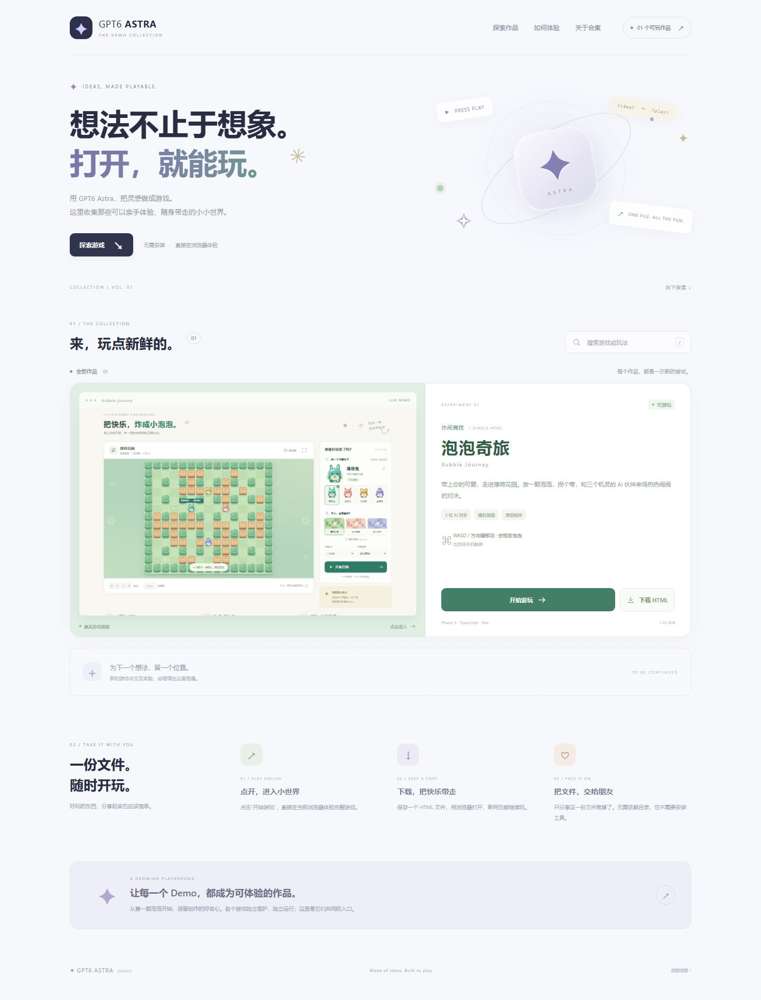

# GPT6 Astra Demos

网页游戏与交互 Demo 合集。每个游戏独立维护，统一构建为可浏览的合集站点，并保留可直接分享的单文件 HTML。

**无需构建：[下载泡泡奇旅 ZIP](https://github.com/AdamWen95/gpt6-astra-demos/raw/refs/heads/main/downloads/bubble-journey.zip)。** 解压后得到唯一的 `bubble-journey.html`，用浏览器打开即可离线游玩，无需安装 Node.js 或其他依赖。



## 作品

| 游戏 | 内容 | 源码 | 成品下载 |
| --- | --- | --- | --- |
| 泡泡奇旅 · Bubble Journey | 原创泡泡竞技、3 位 AI、随机地图、道具、触屏与音效 | [游戏说明](games/bubble-journey/README.md) | [下载 ZIP（推荐）](https://github.com/AdamWen95/gpt6-astra-demos/raw/refs/heads/main/downloads/bubble-journey.zip) · [HTML 原文件](https://github.com/AdamWen95/gpt6-astra-demos/raw/refs/heads/main/downloads/bubble-journey.html) · [校验值](downloads/SHA256SUMS.txt) |

合集首页支持搜索、进入游戏、下载 HTML 与手机布局。清单只包含实际可玩的作品；新游戏通过 `demos.json` 注册。

所有成品直接保存在仓库的 [downloads/](downloads/README.md)，不需要 Git 标签或 Release。GitHub 的 HTML 原文件链接可能显示为文本，可用“另存为”保存为 `.html`；优先下载 ZIP 更方便。浏览器首次交互后开启声音；若聊天软件预览不能运行 HTML，请先保存文件，再使用浏览器打开。

## 本地开发

需要 Node.js 22.12+ 和 npm；本轮使用 Node.js 24.19.0 / npm 11.17.0。统一使用根目录的 `package-lock.json`：

```bash
npm ci
npm run dev
```

`dev` 先构建全部已登记作品，再在 `http://127.0.0.1:4173/` 打开合集预览。它不是热更新服务器；修改首页后重新执行 `npm run build` 并刷新页面即可。单独开发《泡泡奇旅》可使用 Vite 热更新入口：

```bash
npm run dev:game
```

游戏开发地址为 `http://127.0.0.1:5173/`。

## 统一命令

以下命令均在仓库根目录执行：

| 命令 | 用途 |
| --- | --- |
| `npm run build` | 先验证清单，构建各游戏单文件，再生成合集 `dist/` |
| `npm run preview` | 预览已构建的合集，不重新构建 |
| `npm run build:single` | 为所有游戏重新生成各自的单 HTML，不更改现有合集 |
| `npm test` | 合集清单 / 安全边界测试，加各游戏单元测试 |
| `npm run test:e2e` | 合集首页、搜索、下载、进入游戏、子路径与移动布局测试 |
| `npm run test:single` | 各游戏的离线单 HTML 测试，包含自然结束的完整对局 |
| `npm run test:game` | 《泡泡奇旅》的 Vite 开发版浏览器测试 |
| `npm run package` | 重新构建合集并生成 `release/gpt6-astra-demos-1.0.0.tar.gz` 和 SHA-256 |

单独构建或测试某个游戏时，使用 npm workspace 参数，例如：

```bash
npm run build --workspace=bubble-journey
npm run build:single --workspace=bubble-journey
npm run test --workspace=bubble-journey
```

## 目录

```text
gpt6-astra-demos/
├── demos.json                   # 可玩作品清单
├── downloads/                   # 可直接下载的 HTML、单文件 ZIP 与校验清单
├── package.json                 # 统一命令与 npm workspaces
├── package-lock.json            # 唯一依赖锁文件
├── site/                        # 合集首页模板、样式、交互
├── scripts/                     # 清单校验、统一构建、预览和打包
├── tests/                       # 合集单元与浏览器测试
├── games/
│   └── bubble-journey/
│       ├── src/                 # 游戏代码与程序化美术
│       ├── public/
│       ├── scripts/
│       ├── tests/
│       ├── docs/
│       ├── package.json         # 本游戏自己的依赖与构建命令
│       ├── release/             # 生成的 bubble-journey.html
│       └── README.md
├── deploy/nginx.conf            # 合集静态托管模板
├── docs/                        # 合集维护、部署和迁移说明
├── dist/                        # 生成产物，不提交
│   ├── index.html               # 合集首页
│   ├── bubble-journey/index.html # 可独立分享的游戏
│   └── manifest.json            # 每个文件的 SHA-256
└── release/                     # 生成的合集发布包，不提交
```

实际本地文件夹名称可以不同；仓库 / 根包名称为 `gpt6-astra-demos`，不要求更改编辑器已打开的工作区路径。

## 分享与部署

- **分享整个合集**：托管 `dist/` 或解压合集发布包。首页使用相对链接，可部署在网站根目录或 `/gpt6-astra-demos/` 等子路径。
- **只分享一个游戏**：从本页下载成品，或发送构建后的 `games/bubble-journey/release/bubble-journey.html`。`dist/bubble-journey/index.html` 是同一份内容，复制并重命名后也能独立打开。
- **本地离线体验**：在支持执行本地 HTML 的浏览器中打开文件。音频需首次交互，战绩存储能力取决于浏览器；不提供多人联机或云存档。

首页可以直接从本地 `dist/index.html` 打开，但要保持游戏子目录；只有各个游戏 HTML 是完全独立的分享文件。

[部署说明](docs/DEPLOYMENT.md) · [新增游戏](docs/ADDING-GAMES.md) · [源码发布边界](docs/REPOSITORY.md) · [迁移与验证记录](docs/MIGRATION.md)

## 浏览器验证

```bash
npx playwright install chromium webkit
npm run build
npm run test:e2e
npm run test:single
```

浏览器已安装在自定义目录时，设置 `PLAYWRIGHT_BROWSERS_PATH`。如系统临时目录不允许自动化浏览器写入，可为当前终端把 `TEMP` / `TMP` 指向项目内 `.qa/browser-tmp/`；不需要更改系统权限或个人浏览器资料。测试产物和浏览器缓存均被忽略。

每个游戏保持自己的技术栈与依赖声明，根目录只负责组织和构建。游戏中使用的第三方许可随单 HTML 保留，原始许可文本也保存在各自 `public/` 中。实际主机资料、原始报告和日志不纳入公开仓库。
