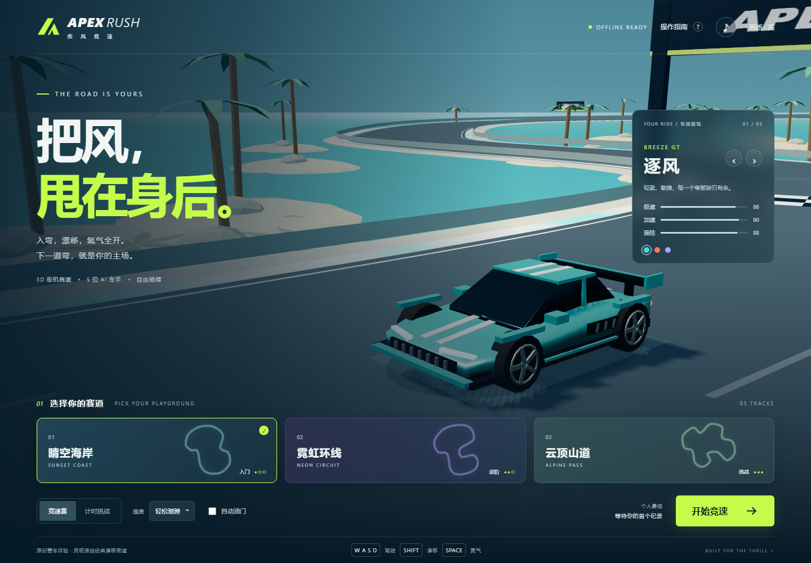

# 疾风竞速 · Apex Rush

受经典漂移赛车玩法启发的原创 3D 街机赛车。赛车、赛道、界面和音效均为本项目制作，不包含 QQ 飞车的商标、原版模型、音频或地图资源。



## 游玩

打开 [独立 HTML](../../downloads/apex-rush.html)，或者解压 [ZIP](../../downloads/apex-rush.zip) 后用浏览器打开。无需服务器、网络、账号或安装依赖。需要支持 WebGL 2 的浏览器；硬件加速关闭或显卡不可用时会显示恢复提示。

- 三条封闭赛道：晴空海岸、霓虹环线、云顶山道，各自独立路线、环境与高程。
- 三辆跑车：逐风、赤焰、星芒，极速、加速度与操控不同。
- 两圈竞速赛：与五位 AI 车手比赛，可选轻松/高手难度。
- 两圈计时挑战：独自练习，记录各赛道与车型的个人最佳。
- 漂移集气、出弯小喷、双瓶氮气、加速带、护栏与车辆碰撞。
- 小地图、实时排名、圈速、结算、合成引擎/漂移音效、追尾镜头切换。
- 触屏多指操作、自动油门、失焦暂停、画质切换、音量开关。

| 操作 | 按键 |
| --- | --- |
| 加速 / 刹车 | W / S 或 ↑ / ↓ |
| 左右转向 | A / D 或 ← / → |
| 漂移 | Shift + 转向，速度需超过约 62 km/h |
| 氮气 | 空格或 Ctrl，每次按下释放一瓶 |
| 小喷 | 保持漂移至少 0.45 秒后松开，近期碰撞时不触发 |
| 回到赛道中央 | R，会损失速度，不增加里程 |
| 切换镜头 | C |
| 暂停 / 继续 | Esc / P |
| 静音 | M |

触屏设备默认自动油门；可同时按方向、漂移或氮气。触点取消、页面失焦或切到后台都会释放输入。桌面自动油门默认关闭。

## 开发

在 `gpt6-astra/` 目录使用合集锁文件：

```bash
npm ci
npm run dev --workspace=apex-rush
npm run test --workspace=apex-rush
npm run build:single --workspace=apex-rush
npm run test:e2e --workspace=apex-rush
npm run test:single --workspace=apex-rush
```

开发端口 5174。普通构建 `npm run build --workspace=apex-rush`；合集构建 `npm run build`。`release/apex-rush.html` 是完整单文件，许可内嵌，禁用所有网络请求，生产包不包含开发诊断接口。浏览器测试沿用根目录 Playwright，可设置 `PLAYWRIGHT_BROWSERS_PATH` 指向已有浏览器。

## 范围

单人本地街机竞速，不包含多人联网、道具赛、原版地图/角色、账号、商店或云存档。物理使用赛道坐标约束以获得易上手的漂移体验，不是轮胎/悬挂真实物理模拟。个人纪录保存在当前浏览器；隐私模式或限制存储时会提示纪录未持久保存。

画质“流畅”关闭实时阴影并降低像素倍率。移动端布局与触控经过浏览器模拟验证；具体实体手机、低端 GPU 和真实 Safari 的表现不能由模拟测试替代。

[架构决定](docs/adr/0001-track-space-racing.md) · [本轮验证](docs/VERIFICATION.md)
