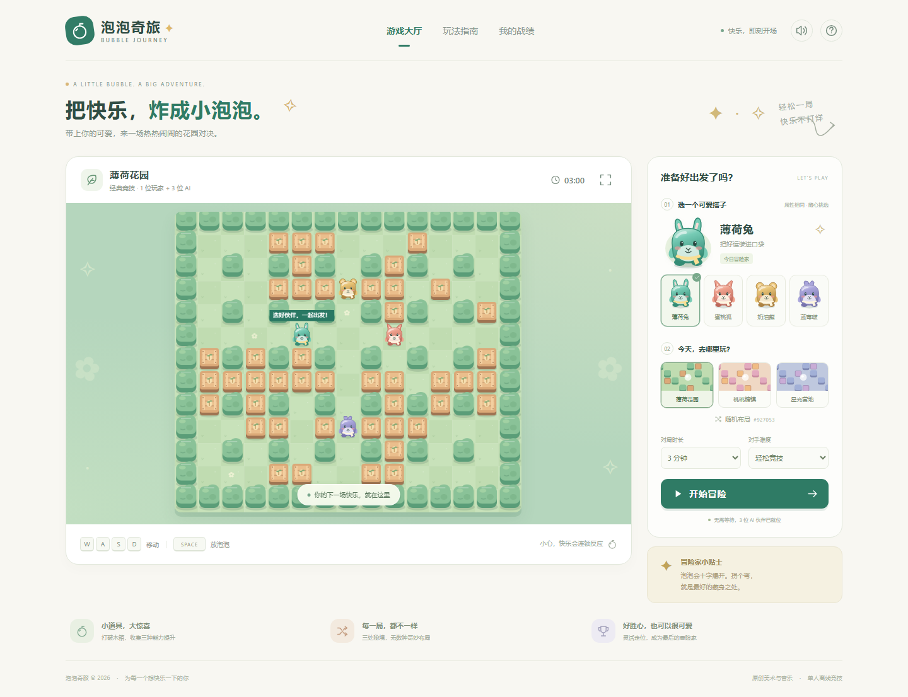

# 泡泡奇旅 · Bubble Journey

原创俯视角泡泡竞技网页游戏，使用 **Phaser 3.90 + TypeScript 5.9 + Vite 8**。一位本地玩家对战三位自主 AI，纯浏览器计算，无后端、登录、外部素材请求或付费服务。

可在本地开发，也可将纯静态生产包部署到自己的 Nginx 站点。安装和部署均不需要游戏服务端或 API 密钥。



## 直接下载游玩

**[下载 ZIP（推荐）](../../downloads/bubble-journey.zip?raw=true)** · [HTML 原文件](../../downloads/bubble-journey.html?raw=true)（约 1.22 MiB） · [SHA-256 校验值](../../downloads/SHA256SUMS.txt)

ZIP 中只有一个完整 HTML，解压后用浏览器打开即可离线游玩。HTML 原文件链接若显示为文本，请另存为 `.html`。无需安装 Node.js、运行开发服务器或下载源码。下面的命令仅供开发和自行构建使用。

## 本地开发

本游戏位于 `gpt6-astra/games/bubble-journey/`，是 GPT-6 Astra 合集的独立 workspace。需要 Node.js **22.12+**（初次验证使用 24.19.0）和 npm。以下命令从 `gpt6-astra/` 目录执行，依赖由该目录的锁文件管理。游戏资源路径未特别说明时相对于本游戏目录。

```bash
npm ci
npm run dev:game
```

访问终端显示的 `http://127.0.0.1:5173/`。源码入口与常规 `dist/index.html` 应通过 HTTP 服务打开；如需双击直接游玩，请使用下面的单文件分享版。

```bash
npm run build --workspace=bubble-journey
npm run build:single --workspace=bubble-journey
npm run preview --workspace=bubble-journey -- --port 4174
npm run package --workspace=bubble-journey
```

以上产物分别位于本游戏的 `dist/` 和 `release/`。预览使用 4174，避免与合集的 4173 冲突。打包需要系统 `tar`；根锁文件固定依赖版本，没有单独维护第二份游戏锁文件。

## 单文件分享

运行 `npm run build:single --workspace=bubble-journey` 后，将 **`games/bubble-journey/release/bubble-journey.html` 这一份文件**发给别人即可。根目录 `npm run build` 还会将同一内容收集到 `dist/bubble-journey/index.html`。接收者下载后用浏览器打开，无需 Node.js、开发服务器、额外资源目录或网络连接。

分享版约 1.22 MiB，内嵌 Phaser 引擎、游戏代码、CSS、图标和第三方许可；角色、地图、音乐与音效仍由代码生成。支持完整大厅、AI 对局、道具、暂停、结算及触屏操作。它使用独立的内存构建，不覆盖常规 `dist/` 或已有生产压缩包。

声音需要首次点击后开启；战绩保存取决于浏览器对本地文件存储的支持，存储不可用时仍可游玩并查看当前会话战绩。若聊天软件的文件预览无法运行游戏，请先下载，再用浏览器打开。详细说明和验证范围见 [单文件分享说明](docs/SHARING.md)。

## 如何游玩

1. 在大厅选择薄荷兔、蜜桃狐、奶油熊或蓝莓啵。四个原创角色初始能力相同。
2. 选择薄荷花园、桃桃糖镇、星光营地；点击“随机布局”可预览新的地图。选择 2 / 3 / 4 分钟与轻松 / 高手难度。
3. 点击“开始冒险”，3 秒倒计时后开始对局。

| 操作 | 电脑 | 手机 / 触屏 |
| --- | --- | --- |
| 移动 | WASD 或方向键，可长按 | 长按屏幕方向按钮 |
| 放泡泡 | 空格，每次按下放一颗 | 点击“放泡泡” |
| 暂停 / 恢复 | Esc、P 或顶部暂停按钮 | 顶部暂停按钮 |
| 重开 / 返回大厅 | 对局侧栏或暂停菜单 | 对局下方或暂停菜单 |
| 全屏 | 竞技场右上角按钮 | 浏览器支持时可用 |

泡泡 **2.4 秒**后沿十字方向爆开，爆炸持续 **0.56 秒**。绿篱、糖果墙和水晶墙不可破坏；木箱 / 礼盒可被摧毁且阻挡本次爆炸。命中的其他泡泡立即引爆。角色可以走出刚放下的泡泡，但不能再穿回去；命中爆炸立即淘汰，无复活或队友救援机制。

| 道具 | 效果 | 上限 |
| --- | --- | --- |
| 泡泡口袋（绿） | 同时放置数量 +1，初始 1 | 5 |
| 能量星（黄） | 爆炸范围 +1，初始 2 格 | 7 格 |
| 轻盈鞋（紫） | 移动速度 +1，初始 1 级 | 5 级 |

破坏箱子有 48% 概率掉落道具。新掉落物在当前爆炸消退后出现，已经出现的道具会被后续爆炸摧毁。

**计分：**箱子 +10、道具 +25、淘汰其他角色 +200、获胜 +500。自我淘汰不计淘汰分。只剩一人立即获胜；同一模拟步内全员被淘汰为平局。超时后只比较存活者的积分，最高分并列为平局。自己淘汰后可以观战，也可以重新开局。

战绩保存在当前浏览器的 `localStorage`，最多保存最近 20 局，界面显示最近 8 局。只有正常结束的对局计入战绩，放弃 / 重开不计入。损坏或不可访问的本地存储不会阻止游玩；无法写入时只在当前页面保留记录。无账号同步和在线排行榜。

## 已实现内容

- 大厅 / 开始菜单、角色选择、地图预览、随机布局、难度与时长设置。
- 固定时间步长对战、格子碰撞与连续移动、炸弹数量限制、十字爆炸、连锁反应、道具、淘汰和结算。
- 三个 AI：广度优先寻路、连锁爆炸时间预测、逃生路线检查、收集道具、破箱与主动攻击。AI 使用同一规则模型，不瞬移、不穿墙、不修改分数。
- 角色摆动与背面朝向、泡泡脉动 / 抖动 / 倒计时圆环、十字光效、粒子、轻微震屏、支持系统“减少动态效果”。
- 原创 Web Audio 旋律、放弹 / 爆炸 / 拾取 / 淘汰 / 胜负音效、静音、音乐单独开关。遵守浏览器自动播放规则，首次交互后才开启音频。
- 键盘与触屏、响应式桌面 / 手机布局、全屏与不支持时的提示、切换标签或窗口失焦自动暂停、弹窗焦点限制。
- 纯静态构建、相对资源路径、缓存友好的哈希资源、Nginx 示例、发布清单与 SHA-256。

## 项目结构

```text
src/
  game/types.ts       规则常量、数据模型、种子随机数
  game/map.ts         地图生成与四角逃生空间
  game/match.ts       纯 TypeScript 对战模型，不依赖 Phaser / DOM
  game/ai.ts          危险预测、BFS、AI 决策
  game/scene.ts       Phaser 场景、固定步长驱动、动画与粒子
  game/input.ts       键盘和 Pointer Events 输入生命周期
  art/                原创 SVG 角色、程序化 Canvas 地图纹理
  ui/                 大厅、弹窗、图标和样式
  audio.ts            Web Audio 合成器与原创旋律
  storage.ts          本地偏好和战绩边界校验
  main.ts             页面交互、状态转换与场景装配
tests/unit/           规则、AI 与随机地图测试
tests/e2e/            Playwright 完整游戏流程
deploy/nginx.conf     Linux Nginx 虚拟主机模板
docs/                 架构、通用部署说明和验证摘要
docs/images/          经审阅的游戏展示图
release/              本地生成的生产压缩包与校验清单（不纳入 Git）
```

详细设计见 [架构说明](docs/ARCHITECTURE.md)，上线步骤见 [Linux / Nginx 部署](docs/DEPLOYMENT.md)，历史测试范围见 [验证记录](docs/VERIFICATION.md)。上传源码前的文件边界见 [仓库发布说明](../../docs/REPOSITORY.md)。

## 测试

```bash
npm run test --workspace=bubble-journey
npx playwright install chromium firefox webkit
npm run test:game
npm run test:single --workspace=bubble-journey # 先运行 build:single
```

受限环境可设置 `PLAYWRIGHT_BROWSERS_PATH` 到项目内目录。例如 PowerShell：

```powershell
$env:PLAYWRIGHT_BROWSERS_PATH = "$PWD\.browsers"
npx playwright install chromium firefox webkit
npm run test:game
```

测试会启动 / 复用本地开发服务器；完整对局测试让真实 Phaser 循环和 AI 自然运行到结果，不注入胜利状态或跳过时间。报告在游戏目录的 `playwright-report/`，失败时保留 trace 与截图。本机此前 Firefox 自动化启动受环境限制；可用 `npm run test:game -- --project=chromium --project=webkit --project=mobile-chromium --project=mobile-webkit --workers=2` 选择已验证的项目，测试范围与历史日期见验证记录。

## 素材与适用范围

所有角色、图标、地图纹理、旋律与音效均由项目代码原创绘制 / 合成，没有使用 QQ 堂的名称标识、原版角色、地图、音乐或音效。“经典泡泡炸弹竞技”仅为玩法参考。运行时仅依赖 Phaser 与其 eventemitter3 依赖，MIT 许可文本随生产包分发。

这是**单人本地竞技游戏**。不包含多人联机、账号、匹配服务器、内购或云存档。常规网站版首次加载需要 HTTP 服务，未实现 Service Worker；单文件分享版将完整资源嵌入 HTML，下载后可以离线重新打开。手机浏览器兼容性以仿真测试为依据，真机触感、低端 GPU 和真实扬声器听感仍需实机复核。
