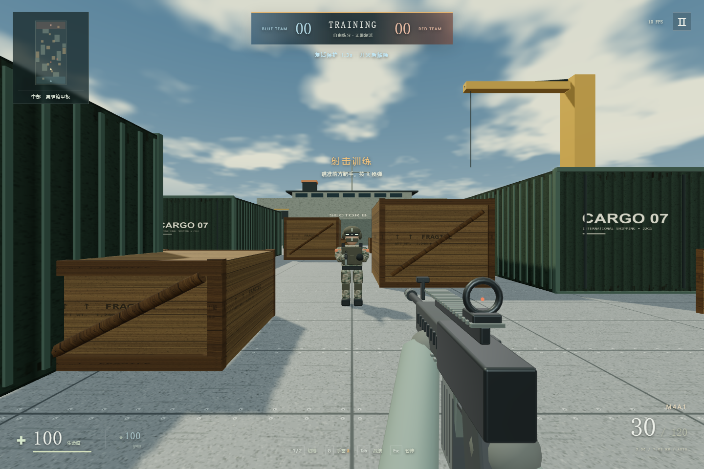

# 运输船 · Cargo Strike

一个独立、离线可玩的 3D 第一人称团队枪战页面。参考《穿越火线》经典运输船的空间特征，重新制作场景、材质、枪械与角色：对称出生区、交错木箱、绿色集装箱、中央交火线、两侧有顶通道和台阶高台。



这是非官方的爱好者重制作品，不包含原游戏提取的模型、贴图、声音或商标素材。布局按公开参考重新搭建，没有原始关卡尺寸，不宣称逐点、逐像素一致。采用程序化建模与材质，画面属于浏览器实时 3D，未达到商业游戏的扫描资产和角色动画精度。

## 可玩内容

- 4 对 4 团队竞技：玩家 + 3 名蓝方 AI，对抗 4 名红方 AI。10 / 20 / 40 击杀目标，分别限时 2 / 3 / 5 分钟。
- 3 档 AI 难度，寻路、视线遮挡、反应时间、射击散布、侧移、换弹、死亡与复活。
- M4A1、AK-47、AWP 三种主武器和 M9 副武器；开镜、后坐力、移动散布、爆头、护甲、有限弹药和可取消换弹。
- 手雷投掷、弹跳、定时爆炸、距离衰减与掩体遮挡。队友免伤，复活保护在开火时解除。
- 冲刺、跳跃、蹲下、掩体碰撞、侧道登高；小地图、击杀信息、战绩面板、对局结算与重开。
- 自由练枪模式：静止靶手、目标自动复活。弹药有限，可在暂停菜单重新开始。
- Web Audio 合成射击、换弹、脚步与击杀音效；远处枪声有距离衰减和左右声像。
- 触屏双区移动 / 瞄准和开火按钮；音量、灵敏度及画质设置本地保存。

不包含真人联网、原作全部武器、可破坏场景或真实枪械弹道模拟。子弹采用即时射线检测，枪械参数针对本作的竞技节奏调整。

## 操作

| 输入 | 操作 |
| --- | --- |
| WASD / 方向键 | 移动 |
| 鼠标 / 左键 / 右键 | 转向 / 射击 / 精确瞄准 |
| R / 1 / 2 | 换弹 / 主武器 / 副武器 |
| Shift / 空格 / Ctrl 或 C | 冲刺 / 跳跃 / 蹲下 |
| G / Tab / Esc | 手雷 / 战绩 / 暂停 |

点击进入战场时申请鼠标锁定；按 Esc 释放并暂停。浏览器不支持锁定时，可以按住鼠标拖动转向。触屏左侧摇杆移动，右侧空白区滑动瞄准，右侧按钮开火 / 开镜 / 换弹 / 跳跃 / 投雷。

## 本地开发与独立成品

在 `gpt6-astra/` 目录运行：

```bash
npm install
npm run dev --workspace=cargo-strike
npm run test --workspace=cargo-strike
npm run build:single --workspace=cargo-strike
npm run test:e2e --workspace=cargo-strike
npm run test:single --workspace=cargo-strike
```

开发地址 `http://127.0.0.1:5175/`。成品为 `release/cargo-strike.html`，复制到任意目录后可以直接离线打开，不需要下载运行时资源。需要 WebGL 2；建议桌面 Chrome / Edge 开启硬件加速，低帧率时切换流畅画质。自动化浏览器可沿用仓库 `.browsers` 和 `.qa/browser-tmp` 配置。

所有模型、Canvas 纹理和音频均在本地生成。Three.js MIT 许可随单 HTML 保留。浏览器仅存储音量、灵敏度、画质偏好，不向外发送任何信息。

[架构决策](docs/adr/0001-local-combat-simulation.md) · [验证记录](docs/VERIFICATION.md)
