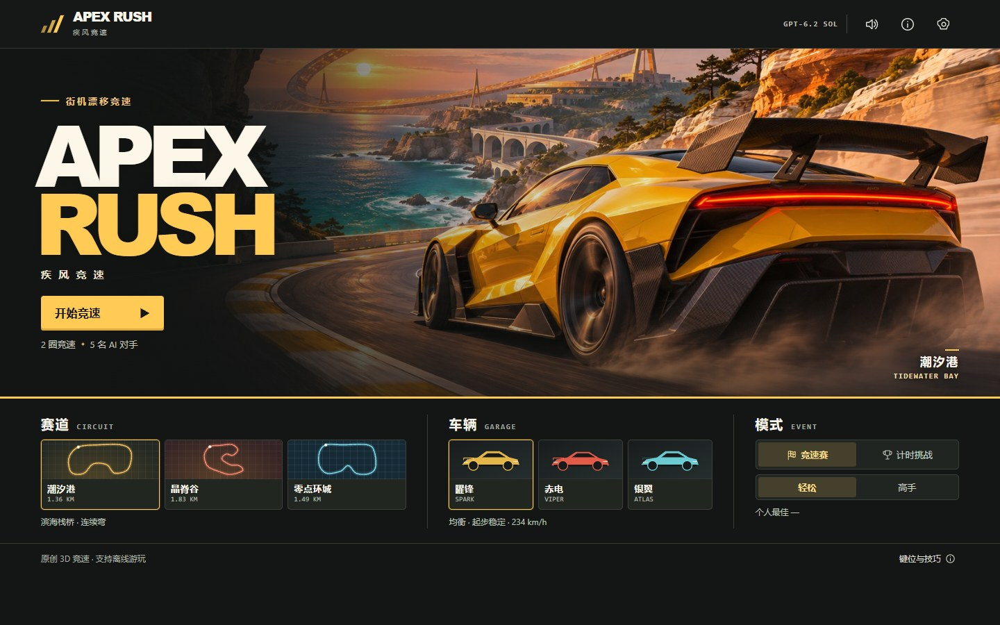

# 疾风竞速 · Apex Rush

GPT-6.2 Sol 对照版。原创 3D 街机漂移赛车，以相同的作品名、交付格式和赛事规模对应 [GPT-6 Astra 版](../../../gpt6-astra/games/apex-rush/README.md)。两版使用独立的赛道、车辆和美术。



## 开始比赛

保存 [apex-rush.html](../../downloads/apex-rush.html) 后直接用浏览器打开，或解压 [apex-rush.zip](../../downloads/apex-rush.zip) 后打开其中的 HTML。需要支持 WebGL 2 的浏览器；车辆、场景、音效和大厅主视觉均内置。

| 对照项 | Sol 版 |
| --- | --- |
| 赛道 | 潮汐港、晶脊谷、零点环城，有各自的坡度、弯道、加速带与景观 |
| 车辆 | 曜锋、赤电、银翼，极速、起步加速和转向灵敏度各异 |
| 竞速赛 | 两圈，5 名 AI 车手，可选轻松或高手 |
| 计时挑战 | 两圈单人，按赛道和车型记录个人最佳 |
| 比赛反馈 | 即时排名、小地图、圈速、结算、两种跟车镜头、合成引擎音和漂移音 |

| 操作 | 按键 |
| --- | --- |
| 加速、刹车、转向 | WASD 或方向键 |
| 漂移集气 | 约 62 km/h 以上按住 Shift 并转向 |
| 出弯小喷 | 连续漂移至少 0.45 秒后松开 Shift |
| 氮气 | Space 或 Ctrl，每次消耗一瓶，最多储存两瓶 |
| 回正 | R，损失车速 |
| 切换镜头、静音 | C、M |
| 暂停、继续 | Esc 或 P |

触屏默认开启自动油门，可以同时转向和漂移。页面失焦会暂停比赛并释放输入。设置可切换画质、静音与自动油门。个人最佳保存在当前浏览器，浏览器禁用本地存储时会保留在当前会话。

## 本地开发

在本目录使用 Node.js 22.12 或更新版本。

```sh
npm ci
npm run dev
npm test
npm run build
npm run build:single
npx playwright install chromium
npm run test:browser
```

开发地址为 `http://127.0.0.1:5175/`。单文件构建输出到 `release/apex-rush.html`。浏览器脚本默认检查这份文件，也可以通过 `APEX_TEST_URL` 检查开发版。Windows 可设置 `APEX_CHROMIUM_CHANNEL=chrome` 使用已安装的 Chrome。没有硬件 WebGL 时可设置 `APEX_SOFTWARE_GL=1`。

核验单文件后，可用 `npm run package:download -- YYYY-MM-DD` 更新模型目录内的 HTML、ZIP 和校验记录。替换参数为实际的验证日期。

两圈赛事由固定步长的纯 TypeScript 模拟推进。车辆沿赛道中心线的累计距离和横向偏移独立运动，使用赛道曲率辅助转向，圈次按连续距离跨过计时线结算。Three.js 负责显示车辆、赛道和特效，HUD 和触控通过 HTML 实现。这个划分让赛道、碰撞、计时和 AI 可以独立验证，也让画质切换不影响比赛规则。

[本轮验证](docs/VERIFICATION.md)

## 大厅主视觉

使用内置图像生成工具制作 [潮汐港主视觉](src/art/tidewater.jpg)，游戏中的赛道和赛车由 Three.js 实时绘制。

<details>
<summary>生成提示词</summary>

> Use case: racing game key art. Create a polished cinematic landscape cover for an original browser arcade racer, a 3D automotive advertising render. Main subject in the RIGHT half: a single striking sunflower-yellow, wide low-poly-inspired but premium futuristic race coupe with dark aero panels, red tail light strip, carbon rear wing, no logo or registration, seen from a very low rear three-quarter camera. It is sliding toward a bend on a wide warm asphalt circuit overlooking a deep turquoise sea, a gigantic slender amber solar observation ring structure frames the coastal circuit in the middle distance. White and golden concrete curbing, sculptural layered sandstone bluffs and dark pine trees, distant seaside viaduct, clear dramatic pale peach and slate blue sunset sky, warm highlight on car body, realistic motion and a little warm tire haze. Playful arcade proportions with sophisticated realistic light. Make everything especially beautiful and dramatic on the right two-thirds. Left third is dark shadow with subdued detail and charcoal-toned asphalt and cliff, usable behind bright overlaid text. A clean polished automotive campaign frame, asymmetrical, tightly composed, wide 16:9 crop. Car occupies right-center between x=50% and 92%, y=36%-86%. No text, lettering, logos, HUD, watermark, manga characters or extra cars.

</details>
