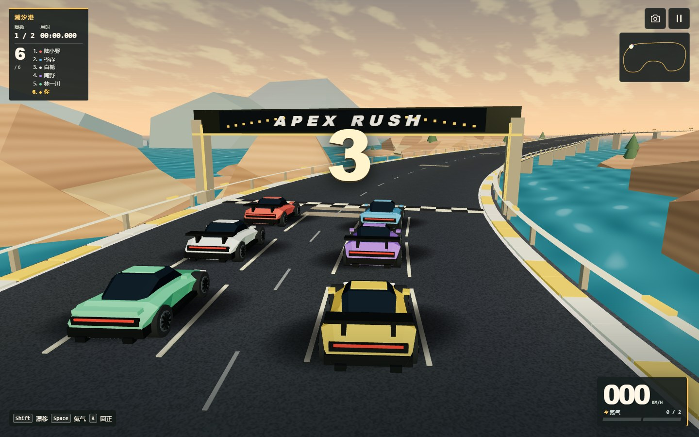
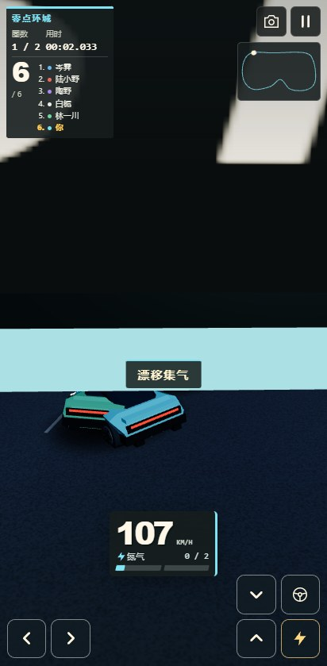
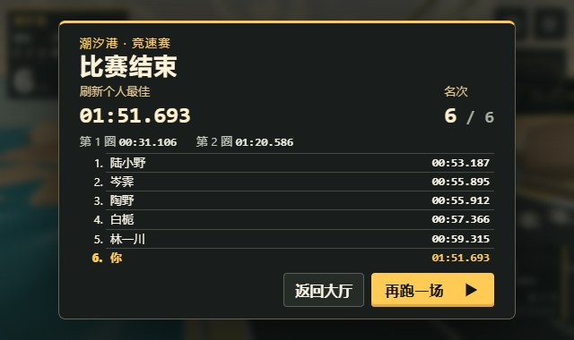

# 疾风竞速 · GPT-6.2 Sol 验证记录

核对日期为 2026-11-19（北京时间）。环境为 Windows、Node.js 24.19.0、Playwright 1.65.0，Chrome 和 Edge 使用 SwiftShader 软件 WebGL 2。浏览器测试针对本轮构建与下载文件。

| 验证层 | 结果 |
| --- | --- |
| 依赖与生产构建 | 使用锁文件离线安装成功。TypeScript 检查、常规 Vite 构建、单文件构建均通过。常规构建提示 Three.js 所在的 JS 文件超过 500 kB。 |
| 模拟规则 | 8 项测试通过。遍历 3 条赛道与 3 辆车的 9 种组合，覆盖两圈计时、漂移与耗气、加速带、碰撞、回正、AI 难度、转向收益及排名顺序。 |
| Chrome 离线桌面 | 直接打开下载目录的 HTML，通过大厅选择、WebGL 画面、AI 排名、键盘加速和制动、漂移集气、镜头、音频节点、暂停、失焦和重开检查。 |
| Chrome 离线触屏模拟 | Pixel 7 视口的竖屏和横屏通过。验证自动油门、同时转向和漂移、触点取消后的释放，以及暂停。 |
| Chrome 离线两圈结算 | 从潮汐港倒计时跑到完赛，显示两圈分段、六名车手成绩和本车名次。640 × 380 视口内可见结算操作，回大厅并刷新后可读到个人最佳。 |
| WebGL 不可用 | 模拟 WebGL 初始化失败后显示恢复提示，可返回大厅。 |
| Edge 本机 HTTP | 使用常规生产构建，进入零点环城计时挑战，键盘加速可用，页面无错误。 |
| 离线包 | 正常离线游玩期间无外部 HTTP 请求、CSP 违规和 JavaScript 错误。ZIP 只有一个根目录 HTML，解压内容与独立 HTML 逐字节一致。HTML 为 1,037,548 字节，ZIP 为 487,354 字节，大小和 SHA-256 均与成品清单一致。 |

实体手机、多款 GPU 的帧率和原生 iOS Safari 尚未验证。浏览器结算测试使用加速的测试时钟，产生的成绩仅用于验证流程。

## 浏览器截图

