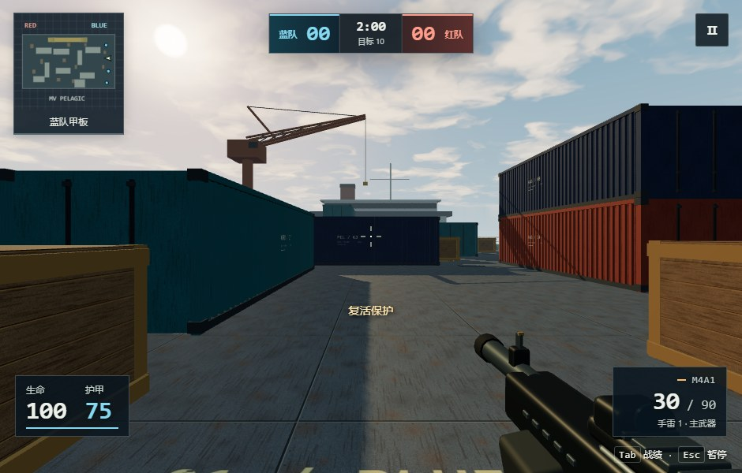

# 运输船 · Cargo Strike

GPT-6.2 Sol 对照版。与 [GPT-6 Astra 版](../../../gpt6-astra/games/cargo-strike/README.md) 使用相同的作品名、交付格式和对局规格。战场是原创的远洋货轮 MV Pelagic，有错位的集装箱、左舷高架维修道、冷柜区和右舷外廊。



## 离线开始

用支持 WebGL 2 的浏览器打开 [cargo-strike.html](../../downloads/cargo-strike.html)，或者解压 [cargo-strike.zip](../../downloads/cargo-strike.zip) 后打开其中的 HTML。场景、贴图和音效均内置。画质、音量和灵敏度保存在当前浏览器。

| 对照项 | Sol 版 |
| --- | --- |
| 团队竞技 | 你和三名蓝方 AI 对阵四名红方 AI。10／20／40 击杀，限时 2／3／5 分钟 |
| 自由练枪 | 四名固定靶手自动复活。弹药有限，可随时重开补充 |
| 武器 | M4A1、AK-47、AWP 三选一，M9 副武器，每次复活一枚手雷 |
| 射击 | 即时射线与掩体遮挡，头部和身体分开判定，移动散布、后坐力、瞄准、护甲和换弹 |
| AI | 三档难度，按地面网格绕开掩体，发现目标后有反应延迟，交火时会横移和调整距离 |
| 地图 | 中央装卸区用于穿插，左舷钢梯可上高架，右舷外廊可沿船身推进 |
| 反馈 | 小地图、击杀信息、方向受击提示、重生倒计时、战绩、结算和空间音效 |

同一浏览器选用相同主武器、AI 难度和击杀目标可以对照两版。对局中的武器数值、AI 和布局均由各版独立设计。

## 操作

| 输入 | 作用 |
| --- | --- |
| WASD 或方向键 / 鼠标 | 移动 / 转向 |
| 左键 / 右键 | 开火 / 瞄准 |
| R / 1 / 2 | 换弹 / 主武器 / 副武器 |
| Shift / 空格 / Ctrl 或 C | 冲刺 / 跳跃 / 蹲下 |
| G / Tab / Esc | 手雷 / 战绩 / 暂停 |

有鼠标锁定时直接移动鼠标转向。浏览器限制鼠标锁定时，在战场画面上拖动转向。触屏左下方摇杆移动，右侧空白区滑动瞄准，右下方按钮控制开火等动作。

## 开发与构建

在本目录使用 Node.js 22.12 或更新版本。

```sh
npm ci
npm run dev
npm test
npm run build
npm run build:single
npx playwright install chromium
npm run test:browser
```

开发地址为 `http://127.0.0.1:5176/`。独立成品输出到 `release/cargo-strike.html`，包含 Three.js 的 MIT 许可。浏览器测试默认使用这份文件，设置 `CARGO_FULL_MATCH=1` 追加真实 AI 整局测试。通过验证后运行 `npm run package:download -- YYYY-MM-DD` 更新 Sol 下载目录和校验清单，日期填写实际验证日。

战斗模拟使用固定时间步，场景和 UI 消费其状态与事件。甲板掩体数据由移动、射线、AI、小地图和 Three.js 场景共享。游戏中的货轮、角色和武器为实时程序化模型，声音由 Web Audio 合成。大厅使用单独生成的 [主视觉](src/art/pelagic.jpg)。提供单机 AI 对局，地图和素材为原创，画面采用适合浏览器运行的模型精度。

[架构决策](docs/adr/0001-combat-and-rendering.md) · [验证记录](docs/VERIFICATION.md)
